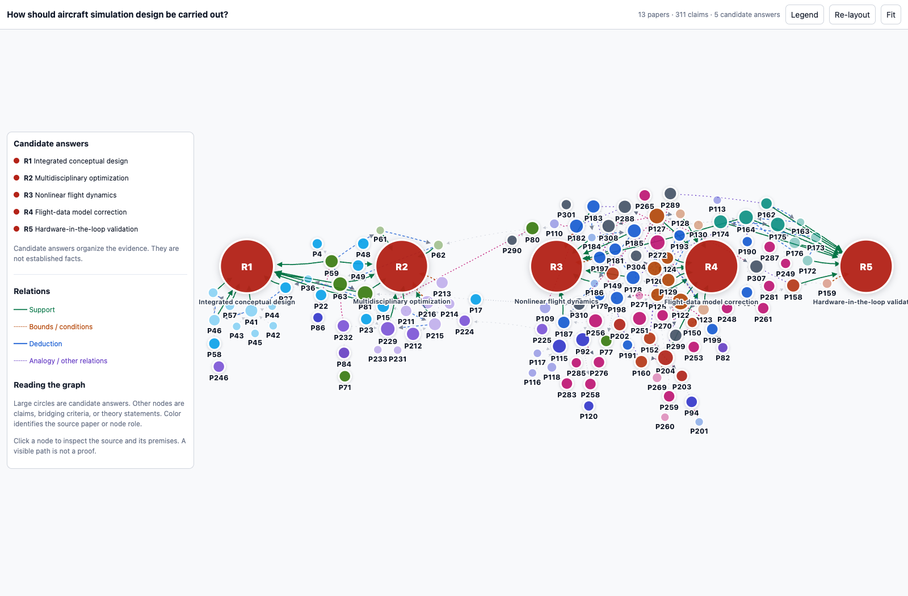
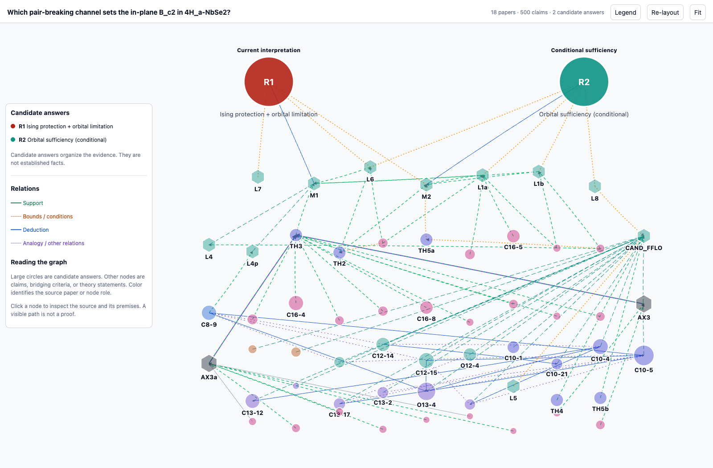

<div align="center">

# Ariadne

An evidence-to-decision tool for scientific research.

<a href="README.zh-CN.md"></a>

</div>

Ariadne helps researchers compare explanations, trace them to paper evidence, and identify what still needs to be verified before making a research decision.

Start with a question. Ariadne retrieves papers, extracts their claims, and connects them to candidate answers in an interactive graph. Follow an answer back to its premises to see what supports it, where it depends on assumptions, and where the evidence runs out.



[From evidence to a decision](#from-evidence-to-a-decision) · [Examples](#examples) · [Get started](#get-started) · [Configuration](#configuration)

## From evidence to a decision

Before choosing a direction, researchers need to check whether results transfer to their setting, which explanations the evidence supports, and what remains uncertain.

| Research question | What to inspect in Ariadne | Decision it helps inform |
| --- | --- | --- |
| Which explanation should I pursue? | Candidate answers and the claims connected to each | Which explanation warrants further investigation |
| Does this result apply to my problem? | Source claims, assumptions, and typed cross-paper relations | Whether the evidence transfers under the required conditions |
| What needs to be verified next? | Conditional support, conflicting claims, and missing premises | Which uncertainty to resolve before committing to a direction |

Ariadne provides the evidence graph and reasoning paths. The researcher uses them to make the decision.

## Examples

### Aircraft simulation design

**How should aircraft simulation design be carried out?**

This case organizes the evidence for choosing modeling and validation steps in an aircraft simulation workflow. The five candidate answers cover conceptual design, multidisciplinary optimization, flight dynamics, model correction, and hardware-in-the-loop validation.

The bundled inputs cover 13 papers, 311 claims, and 223 edges. The offline demo exports 107 paths to the candidate answers: 7 same-paper reading sequences and 100 `infer` exploratory paths. **It produces zero typed support chains** -- deduction is the only chainable relation type, and this graph has none. That is the honest state of the demo, not a rendering bug.

The candidate answers are labelled by how much of their support comes from a second paper: R1 and R2 are `multi-paper` (7+3 and 5+3 claims), while R3-R5 are `single-paper core` (7+1, 9+1, 8+1). Every root records `support_paper_counts`, so the split can be checked rather than inferred.

The red nodes are candidate answers. Green links support an answer; dashed links show other relation types. Select a node to inspect its claim and source, or select an answer to follow its premises.

### Pair breaking in 4Hₐ-NbSe₂

**Which pair-breaking channel sets the in-plane B_c2 in 4H_a-NbSe2?**



This case compares the evidence and assumptions behind two compatible explanations of an observed critical field. The reviewed graph brings together 18 papers and 500 claims; the image focuses on the answer layer.

- **R1 — Ising protection and orbital limitation.** Ising spin–orbit coupling suppresses in-plane Zeeman pair breaking, while orbital and interlayer effects set the main field scale in the current interpretation.
- **R2 — Conditional orbital sufficiency.** A purely orbital explanation can reach the observed field if the anisotropy is large enough, approximately γ ≥ 5.6.

The unresolved issue is whether Ising protection is necessary to explain the measured scale. Following the two answers exposes the assumptions that need independent verification before settling on a mechanism. Cross-material evidence remains labeled by its relation type, allowing the researcher to assess whether it applies to this compound.

The aircraft demo rebuilds the graph and reasoning paths from the bundled inputs. The physics image illustrates a previously reviewed case; it is not a fresh live run.

## Quick start

Three commands, in order. The first two give you a graph; the third tests a
candidate against one.

```bash
./install.sh

# 1. a graph to work with: bundled example (free), your own files, or retrieval
./run.sh demo --out outputs/demo
./run.sh ask "How is aircraft simulation design done?" --top-k 2 --yes
./run.sh ask "..." --papers my-papers.json          # local PDF / Markdown / graph

# 2. test a candidate against that graph
./run.sh support --view outputs/demo/04_question/domain_view_question.json \
  --candidate "Calibrate the aerodynamic model against measured flight-test deltas." \
  --out outputs/support/calibration
```

`ask` writes the same file at `<RUN>/05_outputs/domain_view_question.json`. That
view is the only input `support` needs.

`support` judges the candidate against claims already in the graph. It makes no
LKM calls and never edits the view -- one model call per candidate, plus one
retry if nothing supports it. The report says what it covered:

| Field | Meaning |
| --- | --- |
| `status` | `supported`, `contradicted`, or `unresolved_in_graph` |
| `scope.searched` | `false` unless you passed `--expand` |
| `scope.claims_offered_to_judge` | how many claims the judge actually saw |

So `unresolved_in_graph` means "not in this graph", never "not true". Add
`--expand 4 --yes` to search LKM for related papers first (billable: one search
plus one graph call per paper); the report then says how many papers were usable
and what it cost.

## Setup

Requirements: Python 3.11+, and for live questions a Bohrium account and an
OpenAI-compatible model endpoint. `demo` and `support` need neither.

```bash
npm install -g bohr-cli
./run.sh config init
./run.sh auth bohr
./run.sh doctor
```

`--dry-run` prints the plan and the upper-bound cost without calling anything;
`--yes` authorizes billable LKM calls for one run. Start with `--top-k 2` before
scaling up. `--no-lkm-extract` skips building missing graphs, and
`--no-fulltext` skips PDF parsing.

## Configuration

Configuration lives in `~/.config/ariadne/config.json`; environment variables
override it, and flags override both. See [the example](config.example.json).

| Setting | Purpose |
| --- | --- |
| `model.api_key` | model provider key |
| `model.base_url` | OpenAI-compatible base URL |
| `model.model` | claim extraction and single-paper processing |
| `model.merge_model` | merging and candidate answers |
| `bohr.profile` | Bohr profile; empty uses the active one |
| `runtime.python` | interpreter for pipeline subprocesses |
| `retrieval.max_extractions` | cap on missing graphs to build |

`ARIADNE_WORKERS` (default 4) sets how many papers, searches and extractions run
at once; it only changes wall-clock time. Set it to 1 for the old sequential
order. For CI, set `DEEPSEEK_API_KEY` (or `OPENAI_API_KEY`) and `BOHR_ACCESS_KEY`
instead of a config file.

`--papers` takes a JSON spec of local `graph_path` / `ocr_path` files or LKM ids,
so uploading and retrieving end in the same artifact.

## How it works

```text
Question → LKM retrieval → Claim extraction → Single-paper graphs
         → Cross-paper merge → Candidate answers → HTML graph + reasoning paths
```

The repository includes the Ariadne CLI, the Gaia pipeline harness, and the three pipelines it invokes. Each run writes to a separate directory under `outputs/ariadne_runs/`.

| Output | Contents |
| --- | --- |
| `domain_viewer_question.html` | Interactive graph with embedded data |
| `ALL_CHAINS_TO_ROOTS.md` | Multi-step paths, with relation types and Mermaid diagrams |
| `run.json` | Run metadata, stage timing, output locations, and a `reproducibility` block: git commit and dirty flag, python version, model names, sha256 of every input graph and text, and prompt versions |
| `01_retrieval/selection.json` | Selected papers and retrieval decisions, for live runs |
| `logs/` | Stage logs |

Relations retain their types: deduction, inference, analogy, bounds, and same-paper reading sequences have different roles. Only deduction relations are eligible to form deductive chains. Candidate answers and visible paths are starting points for examining the evidence; their presence alone does not establish a conclusion.

`run.json` is the answer to "why did this graph change?". It records the commit that produced the run, whether the checkout was dirty, the hash of every input graph and text, and the prompt version of the answer layer. The one thing it cannot record is a sampling temperature: the bundled steps do not pin one, so two runs on the same commit are different samples rather than reruns. That field says `null` on purpose.

Parallelism is per stage, not per run: papers, LKM queries and extractions are independent and run concurrently (`ARIADNE_WORKERS`, default 4), while the three pipelines themselves stay sequential because each one consumes the previous one's output. Results are still emitted in input order, so `selection.json` and the chain export are reproducible.

## Development

One command runs every suite plus the offline demo, and it is the same command CI runs:

```bash
bash scripts/check.sh
```

It exports the right `PYTHONPATH`, runs each suite in its own pytest process (several suites share test file basenames, so collecting them together makes pytest import the wrong module), then runs `ariadne demo` into a temporary directory and asserts that the run record is complete and carries a code fingerprint. No network, no API key, no LKM call.

| Directory | Contents |
| --- | --- |
| `ariadne/` | CLI, configuration, retrieval, orchestration, and tests |
| `agent/` | Pipeline harness, validation, and artifact storage |
| `pipelines/clean_claims/` | Paper-to-claims extraction |
| `pipelines/single_paper/` | Single-paper Gaia IR processing |
| `pipelines/merge/` | Cross-paper merging, answer layer, and rendering |
| `examples/aircraft/` | Inputs for the offline aircraft example |

Extracted from [Gaia IR](https://github.com/CatherineWuleyan/gaia-ir). The compiler dependency is pinned to `gaia-lang==0.5.0a7`. A license has not yet been specified.
