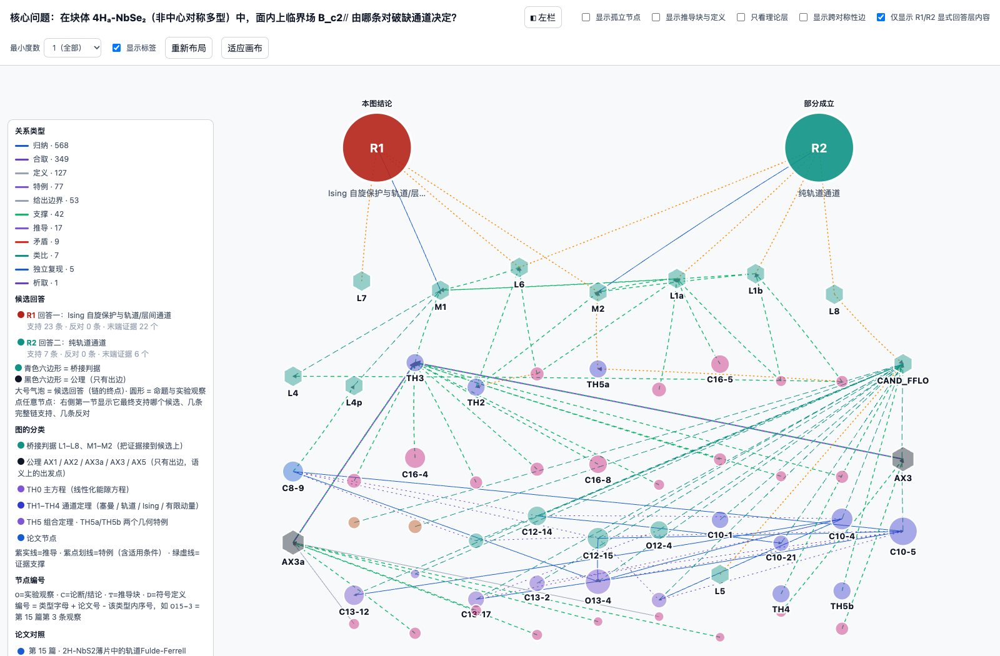

<div align="center">

# Ariadne

让研究决策有据可循。

<a href="README.md"></a>

</div>

Ariadne 是面向科学研究的证据决策工具，帮助研究者比较解释、追溯论文证据，并在选择研究方向前辨认仍需验证的问题。

从一个研究问题出发，Ariadne 检索论文、提取主张，将它们与候选答案连接成可交互的推理图。沿着答案往回读，可以查看它依赖哪些证据、需要哪些前提，以及现有证据还覆盖不到哪里。


[从证据到决策](#从证据到决策) · [示例](#示例) · [开始使用](#开始使用) · [配置](#配置)

## 从证据到决策

找到相关论文之后，研究者还需要判断：论文的结果能否用于自己的问题，某种解释是否得到充分支持，以及哪项不确定性会影响下一步选择。

| 研究问题 | 在 Ariadne 中查看什么 | 帮助做出的判断 |
| --- | --- | --- |
| 哪种解释值得继续研究？ | 候选答案及与之相连的主张 | 优先追查哪种解释 |
| 这个结果适用于我的问题吗？ | 来源主张、成立前提和跨论文关系类型 | 证据能否在所需条件下迁移 |
| 下一步需要验证什么？ | 有条件的支持、相互冲突的主张和缺失前提 | 选择研究方向前，先消除哪项不确定性 |

Ariadne 提供证据图和推理路径，研究者据此作出判断。

## 示例

### 飞机仿真设计

**怎么完成飞机的仿真设计？**

这个案例围绕飞机仿真流程中建模与验证环节的选择组织证据。五个候选答案分别覆盖集成概念设计、多学科优化、飞行动力学、模型校正和硬件在环验证。

随仓库提供的输入涵盖 13 篇论文、311 条主张和 258 条关系。离线示例会生成 107 条通向候选答案的多步路径，方便研究者逐项检查流程选择的依据。

红色大节点是候选答案，绿色连线表示对答案的支持，虚线保留其他关系类型。点击节点可以查看主张和来源，点击答案可以追溯其前提。

### 4Hₐ-NbSe₂ 的对破缺机制

**在块体 4Hₐ-NbSe₂ 中，哪条对破缺通道决定面内上临界场？**



这个案例比较对同一观测的两种相容解释，以及它们各自依赖的证据与前提。复核图汇集了 18 篇论文、500 条主张，配图聚焦于回答层。

- **R1：Ising 保护与轨道限速。** 在当前解释下，Ising 自旋轨道耦合抑制面内塞曼对破缺，轨道和层间效应设定临界场的主要量级。
- **R2：纯轨道机制的条件性充分性。** 若各向异性足够大，约 γ ≥ 5.6，纯轨道解释也可能达到观测到的场强。

尚未解决的是：解释实测场强是否必须引入 Ising 保护。沿着两个答案追溯，可以辨认在确定机制之前，还需要独立验证哪些前提。跨材料证据保留原有的关系类型，供研究者判断它是否适用于该化合物。

飞机示例使用随仓库提供的输入重新生成交互图和推理路径。物理配图展示复核过的案例，不代表一次新的在线运行。

## 开始使用

需要 Python 3.11 或更高版本。在线运行还需要 Bohrium 账户和兼容 OpenAI 接口的模型服务；离线示例不需要账户或密钥。

```bash
git clone https://github.com/CatherineWuleyan/Ariadne.git
cd Ariadne
./install.sh
./run.sh demo
```

在浏览器中打开命令打印的 HTML 路径即可。图的数据已嵌入文件，无需启动服务器。

在线提问前，安装 Bohr 命令行工具并配置账户：

```bash
npm install -g bohr-cli
./run.sh config init
./run.sh auth bohr
./run.sh doctor

./run.sh ask "怎么完成飞机的仿真设计？" --top-k 2 --dry-run
./run.sh ask "怎么完成飞机的仿真设计？" --top-k 2 --no-fulltext --yes
```

`--dry-run` 检查配置并打印计划，不发起付费调用。`--yes` 授权本次运行中的计费 LKM 调用。检索、补建论文图、解析全文和模型调用可能分别计费，以服务商当前价格为准。建议先用两篇论文检查结果，再扩大范围。

## 配置

```bash
./run.sh config init
./run.sh config show
./run.sh config test --api
./run.sh auth status
```

配置保存在 `~/.config/ariadne/config.json`，字段可参考[配置样例](config.example.json)。环境变量覆盖配置文件，命令行参数覆盖两者。

| 字段 | 用途 |
| --- | --- |
| `model.api_key` | 模型服务密钥 |
| `model.base_url` | 兼容 OpenAI 接口的服务地址 |
| `model.model` | 主张提取及单篇处理使用的模型 |
| `model.merge_model` | 跨论文合并及候选答案使用的模型 |
| `bohr.profile` | Bohr 配置名称；留空使用当前配置 |
| `runtime.python` | 运行各阶段子进程的解释器 |
| `retrieval.max_extractions` | 缺失论文图的最大补建数量 |

在终端或持续集成中，可设置 `DEEPSEEK_API_KEY`（或 `OPENAI_API_KEY`）和 `BOHR_ACCESS_KEY`。更换兼容服务时，设置 `ARIADNE_MODEL_BASE_URL`、`ARIADNE_MODEL` 和 `ARIADNE_MERGE_MODEL`。默认服务是已测试过的 DeepSeek；单篇和合并阶段需要支持对话补全的接口。

常用命令：

```bash
./run.sh ask --help
./run.sh ask "研究问题" --papers papers.json --top-k 2
./run.sh ask "研究问题" --no-lkm-extract --top-k 2 --yes
```

`--papers` 可以用本地图文件与文本替代在线检索；仅提供 LKM 编号的条目仍会在线获取论文图。`--no-lkm-extract` 关闭缺图补建。

## 工作原理

```text
问题 → LKM 检索 → 主张提取 → 单篇推理图
     → 跨论文合并 → 候选答案 → 交互图与推理路径
```

仓库包含 Ariadne 命令行、Gaia 流水线运行框架，以及调用的三套处理流程。每次运行分别写入 `outputs/ariadne_runs/` 下的独立目录。

| 产物 | 内容 |
| --- | --- |
| `domain_viewer_question.html` | 内嵌数据的交互图 |
| `ALL_CHAINS_TO_ROOTS.md` | 多步路径、关系类型和 Mermaid 图 |
| `run.json` | 运行信息、阶段耗时与产物位置 |
| `01_retrieval/selection.json` | 在线运行的选文结果和检索决策 |
| `logs/` | 各阶段日志 |

演绎、推断、类比、边界约束和同篇阅读顺序保留各自的关系类型，只有演绎关系可以组成演绎链。候选答案和图中的路径用于引导证据检查，是否足以支持结论仍需逐项判断。

## 开发

```bash
source .venv/bin/activate
PYTHONPATH=.:agent:pipelines/single_paper:pipelines/merge \
  python -m unittest discover -s ariadne/tests -p 'test_*.py'
```

| 目录 | 内容 |
| --- | --- |
| `ariadne/` | 命令行、配置、检索、流程编排和测试 |
| `agent/` | 流水线运行框架、校验与产物存储 |
| `pipelines/clean_claims/` | 从论文中提取主张 |
| `pipelines/single_paper/` | 单篇论文的 Gaia IR 处理 |
| `pipelines/merge/` | 跨论文合并、回答层和渲染 |
| `examples/aircraft/` | 离线飞机示例的输入 |

本项目从 [Gaia IR](https://github.com/CatherineWuleyan/gaia-ir) 提取，编译器依赖固定为 `gaia-lang==0.5.0a7`。仓库暂未指定许可证。
