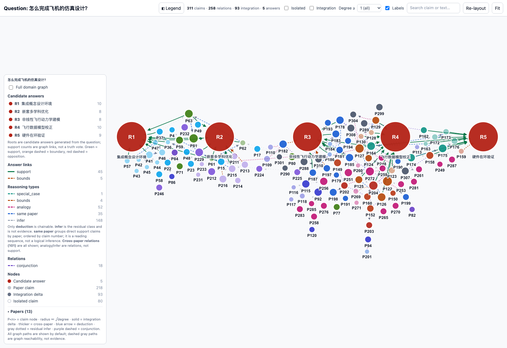

<div align="center">

# Ariadne

从研究问题出发，沿着证据读论文。

<a href="README.md"></a>

</div>

Ariadne 检索 Bohrium LKM 中的论文，提取主张，并将不同论文的主张连接成可交互的推理图。输入一个问题后，可以查看候选答案、追溯它们的前提，以及证据尚未覆盖的部分。



[开始使用](#开始使用) · [示例](#示例) · [配置](#配置) · [工作原理](#工作原理)

## 开始使用

需要 Python 3.11 或更高版本。在线运行还需要 Bohrium 账户和兼容 OpenAI 接口的模型服务；离线示例不需要账户或密钥。

```bash
git clone https://github.com/CatherineWuleyan/ariadne.git
cd ariadne
./install.sh
./ariadne/run.sh demo
```

在浏览器中打开命令打印的 HTML 路径即可。图的数据已嵌入文件，无需启动服务器。

在线提问前，安装 Bohr 命令行工具并配置账户：

```bash
npm install -g bohr-cli
./ariadne/run.sh config init
./ariadne/run.sh auth bohr
./ariadne/run.sh doctor

./ariadne/run.sh ask "怎么完成飞机的仿真设计？" --top-k 2 --dry-run
./ariadne/run.sh ask "怎么完成飞机的仿真设计？" --top-k 2 --no-fulltext --yes
```

`--dry-run` 检查配置并打印计划，不发起付费调用。`--yes` 授权本次运行中的计费 LKM 调用。检索、补建论文图、解析全文和模型调用可能分别计费，以服务商当前价格为准。建议先用两篇论文检查结果，再扩大范围。

## 示例

### 飞机仿真设计

**怎么完成飞机的仿真设计？**

仓库中的飞机图涵盖 13 篇论文、311 条主张和 258 条关系。五个候选答案分别围绕集成概念设计、多学科优化、飞行动力学、模型校正和硬件在环验证组织证据。冻结导出中有 107 条通向这些答案的多步路径。

红色大节点是候选答案，绿色连线表示对答案的支持，虚线保留其他关系类型。点击节点可以查看主张和来源，点击答案可以追溯其前提。

[交互图](outputs/aircraft/final/domain_viewer_question.html) · [推理路径](outputs/aircraft/final/ALL_CHAINS_TO_ROOTS.md) · [答案数据](outputs/aircraft/final/answer_layer.json)

### 4Hₐ-NbSe₂ 的对破缺机制

**在块体 4Hₐ-NbSe₂ 中，哪条对破缺通道决定面内上临界场？**


这份复核示例包含 18 篇论文、500 条主张。完整图有 654 个节点和 1,298 条边，初始视图聚焦于显式回答层。

- **R1：Ising 保护与轨道限速。** 在当前解释下，Ising 自旋轨道耦合抑制面内塞曼对破缺，轨道和层间效应设定临界场的主要量级。
- **R2：纯轨道机制的条件性充分性。** 若各向异性足够大，约 γ ≥ 5.6，纯轨道解释也可能达到观测到的场强。

两个答案相容。尚未解决的是：解释实测场强是否必须引入 Ising 保护。跨材料类比仍标记为类比，不充当该化合物的直接证据。

[交互图](outputs/physics/final/domain_graph_full.reviewed.html) · [复核答案数据](outputs/physics/final/answer_layer.reviewed.json)

这两个示例均为冻结产物。飞机示例可离线重跑回答层；物理示例展示的是复核后的图，不是一次新的在线运行。GitHub 会将 HTML 显示为源码，请下载或克隆仓库后在本地打开。

## 配置

```bash
./ariadne/run.sh config init
./ariadne/run.sh config show
./ariadne/run.sh config test --api
./ariadne/run.sh auth status
```

配置保存在 `~/.config/ariadne/config.json`，字段可参考[配置样例](ariadne/config.example.json)。环境变量覆盖配置文件，命令行参数覆盖两者。

| 字段 | 用途 |
| --- | --- |
| `model.api_key` | 模型服务密钥 |
| `model.base_url` | 兼容 OpenAI 接口的服务地址 |
| `model.model` | 主张提取及单篇处理使用的模型 |
| `model.merge_model` | 跨论文合并及候选答案使用的模型 |
| `bohr.profile` | Bohr 配置名称；留空使用当前配置 |
| `runtime.python` | 运行各阶段子进程的解释器 |
| `retrieval.max_extractions` | 缺失论文图的最大补建数量 |

在终端或持续集成中，可设置 `DEEPSEEK_API_KEY`（或 `OPENAI_API_KEY`）和 `BOHR_ACCESS_KEY`。更换兼容服务时，设置 `ARIADNE_MODEL_BASE_URL`、`ARIADNE_MODEL` 和 `ARIADNE_MERGE_MODEL`。默认服务是已测试过的 DeepSeek；单篇和合并阶段需要支持对话补全的接口。

常用命令：

```bash
./ariadne/run.sh ask --help
./ariadne/run.sh ask "研究问题" --papers papers.json --top-k 2
./ariadne/run.sh ask "研究问题" --no-lkm-extract --top-k 2 --yes
```

`--papers` 可以用本地图文件与文本替代在线检索；仅提供 LKM 编号的条目仍会在线获取论文图。`--no-lkm-extract` 关闭缺图补建。

## 工作原理

```text
问题 → LKM 检索 → 主张提取 → 单篇推理图
     → 跨论文合并 → 候选答案 → 交互图与推理路径
```

仓库包含 Ariadne 命令行、Gaia 流水线运行框架，以及调用的三套处理流程。每次运行分别写入 `outputs/ariadne_runs/` 下的独立目录。

| 产物 | 内容 |
| --- | --- |
| `domain_viewer_question.html` | 内嵌数据的交互图 |
| `ALL_CHAINS_TO_ROOTS.md` | 多步路径、关系类型和 Mermaid 图 |
| `run.json` | 运行信息、阶段耗时与产物位置 |
| `01_retrieval/selection.json` | 在线运行的选文结果和检索决策 |
| `logs/` | 各阶段日志 |

图上的路径不等于证明。只有演绎关系可以组成演绎链；推断、类比、边界约束和同篇阅读顺序保留各自的类型。候选答案用于组织当前证据，出现在图上不代表已被证实。

## 开发

```bash
source .venv/bin/activate
PYTHONPATH=ariadne:agent:pipelines/single_paper:pipelines/merge \
  python -m unittest discover -s ariadne/ariadne/tests -p 'test_*.py'
```

| 目录 | 内容 |
| --- | --- |
| `ariadne/` | 命令行、配置、检索、流程编排和测试 |
| `agent/` | 流水线运行框架、校验与产物存储 |
| `pipelines/clean_claims/` | 从论文中提取主张 |
| `pipelines/single_paper/` | 单篇论文的 Gaia IR 处理 |
| `pipelines/merge/` | 跨论文合并、回答层和渲染 |
| `outputs/aircraft/final/` | 离线飞机示例 |
| `outputs/physics/final/` | 复核后的超导物理示例 |

本项目从 [Gaia IR](https://github.com/CatherineWuleyan/gaia-ir) 提取，编译器依赖固定为 `gaia-lang==0.5.0a7`。仓库暂未指定许可证。
